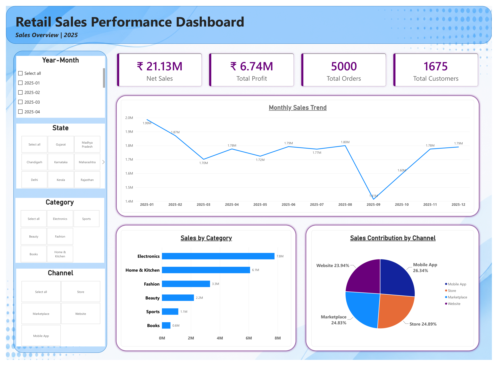
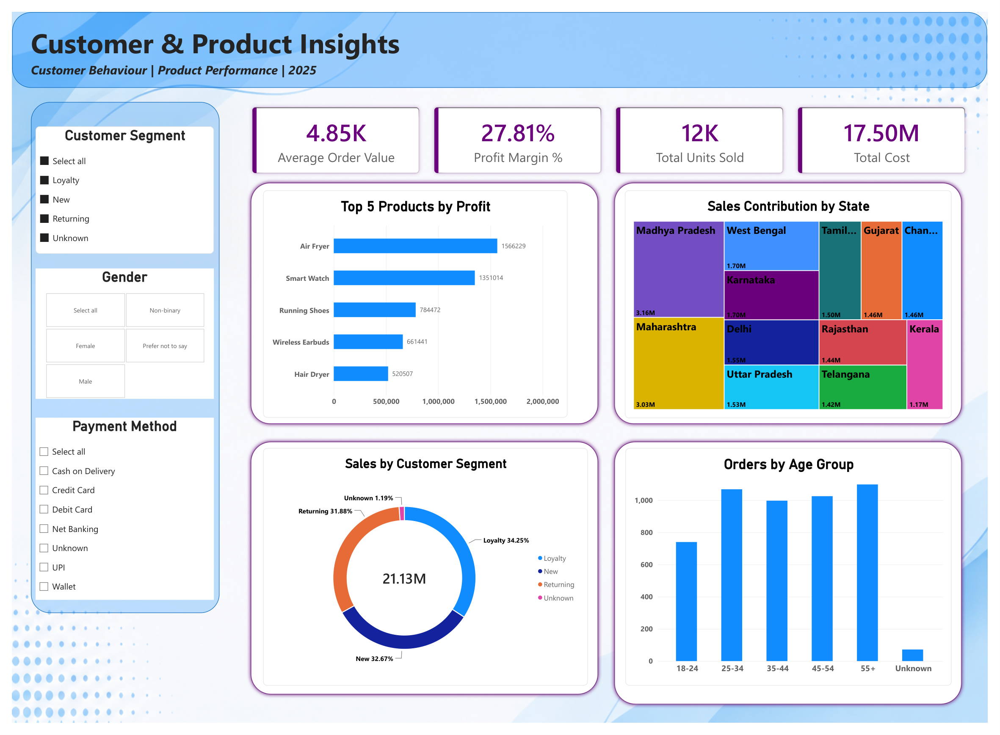

# E-Commerce Sales, Customer & Profitability Analysis

An end-to-end data analytics portfolio project using **Python and Microsoft Power BI** to explore retail sales performance, customer behaviour, product profitability, and business trends.

## Project Overview

This project analyzes synthetic e-commerce sales data to identify business performance trends, customer purchasing behaviour, product performance, geographical sales patterns, and profitability.

The project combines Python-based data analysis and exploratory data analysis (EDA) with an interactive two-page Power BI dashboard.

The objective is to transform raw sales data into meaningful business insights that support data-driven decision-making.

**Dataset Disclaimer:** This project uses a synthetic dataset created for analytical and educational purposes. It does not represent actual company transactions.

## Business Objectives

- Evaluate overall sales and profit performance.
- Identify monthly and quarterly sales trends.
- Analyze category and subcategory performance.
- Identify top-performing products.
- Understand customer purchasing behaviour.
- Compare customer segments and demographics.
- Analyze state-wise and city-wise sales.
- Evaluate payment methods and sales channels.
- Analyze order status and delivery performance.
- Understand the relationship between discounts and profitability.
- Identify loss-making orders, categories, and products.
- Build an interactive dashboard for business reporting.

## Tools & Technologies

| Tool | Purpose |
|---|---|
| Python | Data analysis and processing |
| Pandas | Data manipulation |
| NumPy | Numerical operations |
| Matplotlib | Data visualization |
| Seaborn | Statistical visualization |
| Jupyter Notebook | Exploratory analysis |
| Power BI Desktop | Interactive dashboard development |
| Power Query | Data transformation |
| DAX | KPI calculations and measures |
| VS Code | Development environment |
| Git & GitHub | Version control and project hosting |

## Dataset Information

The cleaned dataset contains **5,000 records and 28 columns**.

It includes information about:

- Orders and order dates
- Customers and customer segments
- Products and product categories
- Quantity and pricing
- Discounts and shipping fees
- Sales, cost, and profit
- Payment methods and sales channels
- Order status and delivery performance
- Customer ratings and demographics
- Data quality indicators

## Project Structure

```text
ecommerce-sales-analysis-python/
│
├── data/
│   ├── raw/
│   └── processed/
│       └── retail_sales_cleaned.csv
│
├── notebooks/
│   ├── 01_Data_Inspection.ipynb
│   ├── 02_Data_Cleaning.ipynb
│   └── 03_Exploratory_Data_Analysis.ipynb
│
├── src/
│   ├── data_loader.py
│   └── eda.py
│
├── outputs/
│   ├── charts/
│   └── reports/
│
├── powerbi/
│   ├── README.md
│   └── Retail_Sales_Analysis_PowerBI.pbix
│
├── reports/
│   ├── README.md
│   ├── Retail_Sales_Analysis_Project_Report.pdf
│   └── Retail_Sales_Analysis_PowerBI_pdf.pdf
│
├── screenshots/
│   ├── README.md
│   ├── dashboard_page_1.png
│   └── dashboard_page_2.png
│
├── .gitignore
├── requirements.txt
└── README.md
```

## Data Cleaning & Preparation

The raw dataset was inspected and cleaned before analysis.

Major cleaning activities included:

- Identifying and removing duplicate records.
- Handling missing values.
- Detecting invalid dates.
- Identifying invalid age, discount, and rating values.
- Correcting invalid quantity values.
- Validating sales and profit calculations.
- Standardizing column names.
- Creating data quality indicator columns.

The final processed dataset contains 5,000 rows and 28 columns.

## Python Exploratory Data Analysis

The Python analysis covers the following areas:

1. Business Performance KPIs
2. Monthly Sales Analysis
3. Quarterly Sales Analysis
4. Category Performance Analysis
5. Subcategory Performance Analysis
6. Top 5 Product Analysis
7. Customer Behaviour Analysis
8. Customer Segment Analysis
9. Gender-wise Analysis
10. Age Group Analysis
11. State-wise Sales Analysis
12. City-wise Sales Analysis
13. Payment Method Analysis
14. Sales Channel Analysis
15. Order Status Analysis
16. Discount Analysis
17. Delivery Performance Analysis
18. Correlation Analysis
19. Loss Analysis

## Power BI Interactive Dashboard

The Power BI dashboard contains two interactive pages designed to provide business-level insights.

### Page 1 — Sales Overview

The Sales Overview page focuses on overall business performance.

**Key Performance Indicators:**

- Net Sales
- Total Profit
- Total Orders
- Total Customers

**Visualizations:**

- Monthly Sales Trend
- Sales by Category
- Sales Contribution by Channel

**Interactive Filters:**

- Month
- State
- Category
- Sales Channel

### Page 2 — Customer & Product Insights

This page focuses on customer behaviour and product performance.

**Key Performance Indicators:**

- Average Order Value
- Profit Margin
- Total Units Sold
- Total Cost

**Visualizations:**

- Top 5 Products by Profit
- Sales Contribution by State
- Sales by Customer Segment
- Orders by Age Group

**Interactive Filters:**

- Customer Segment
- Gender
- Payment Method

Shared Month, State, and Category filters are synchronized across both dashboard pages.

### Dashboard Preview

#### 1. Sales Overview



#### 2. Customer & Product Insights



## Key Business Metrics

### Python Analysis — Recorded Sales

| Metric | Result |
|---|---:|
| Total Orders | 5,000 |
| Total Customers | 1,675 |
| Total Units Sold | 11,897 |
| Recorded Sales | ₹2,42,40,547.70 |
| Total Cost | ₹1,74,98,399.67 |
| Total Profit | ₹67,42,148.03 |
| Average Order Value | ₹4,848.11 |
| Profit Margin | 27.81% |

### Power BI Dashboard — Displayed KPIs

| Metric | Dashboard Value |
|---|---:|
| Net Sales | ₹21.13M |
| Total Profit | ₹6.74M |
| Total Orders | 5,000 |
| Total Customers | 1,675 |
| Average Order Value | ₹4.85K |
| Profit Margin | 27.81% |
| Total Units Sold | 12K |
| Total Cost | ₹17.50M |

**Metric clarification:** Python Recorded Sales includes all order statuses. Power BI Net Sales excludes Cancelled and Returned orders. Therefore, these sales values are not directly comparable.

## Key Business Insights

- Electronics generated the highest category-level sales and profit.
- Home & Kitchen was the highest-performing subcategory by sales.
- Repeat customers contributed approximately 93.99% of recorded sales.
- The 26–35 age group generated the highest sales among age groups in the Python analysis.
- Madhya Pradesh recorded the highest state-level sales in the Python analysis.
- Bhopal recorded the highest city-level sales.
- Mobile App was the leading sales channel by recorded sales.
- Higher discount bands were associated with lower profit margins.
- The dataset contained 116 loss-making orders with a combined loss of ₹26,364.
- In the Power BI dashboard, Air Fryer was the leading product in the Top 5 Products by Profit visual.

## Python Visualizations Gallery

The Python project generates 13 charts covering:

- Monthly sales and profit trends
- Category performance
- Top-performing products
- Customer demographics
- State and city performance
- Sales channels
- Order status
- Delivery performance
- Correlation analysis
- Category-wise and product-wise losses

Charts are stored in the `outputs/charts/` directory.

## Project Documentation & Downloads

- [Detailed Project Report](reports/Retail_Sales_Analysis_Project_Report.pdf)
- [Power BI Dashboard PDF](reports/Retail_Sales_Analysis_PowerBI_pdf.pdf)
- [Power BI Dashboard File](powerbi/Retail_Sales_Analysis_PowerBI.pbix)

The `.pbix` file can be opened using Microsoft Power BI Desktop.

## Installation & Setup — Python

### 1. Clone the Repository

```bash
git clone https://github.com/Vaibhav75058/ecommerce-sales-analysis-python.git
cd ecommerce-sales-analysis-python
```

### 2. Create a Virtual Environment

```bash
python -m venv venv
```

### 3. Activate the Environment

**macOS / Linux**

```bash
source venv/bin/activate
```

**Windows**

```bash
venv\Scripts\activate
```

### 4. Install Dependencies

```bash
pip install -r requirements.txt
```

### 5. Run the Analysis

```bash
python src/eda.py
```

## Future Improvements

- Add advanced customer segmentation.
- Perform sales forecasting.
- Build automated reporting workflows.
- Explore customer retention and cohort analysis.
- Develop additional profitability and operational KPIs.

## Author

**Vaibhav Jha**

Data Analytics Portfolio Project

**Skills Demonstrated:** Python, Pandas, NumPy, Data Cleaning, Exploratory Data Analysis, SQL, Power BI, Power Query, DAX, Data Visualization, and Business Analysis.

---

**Disclaimer:** This project is intended for educational and portfolio demonstration purposes. The dataset is synthetic, and all business insights are based on generated data.
